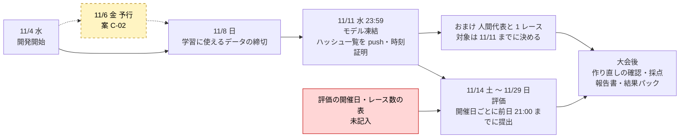
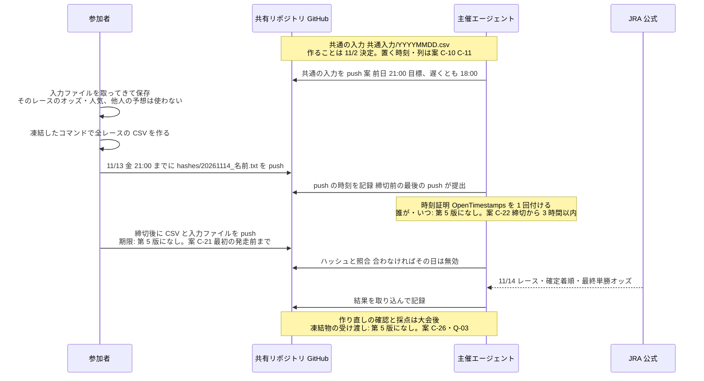
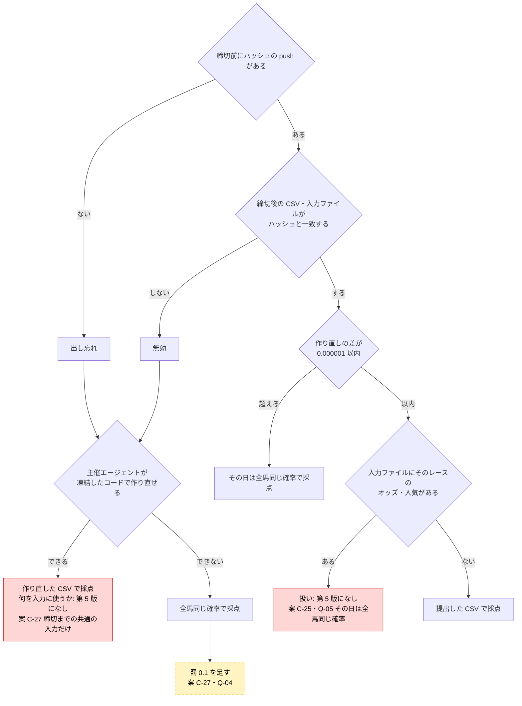
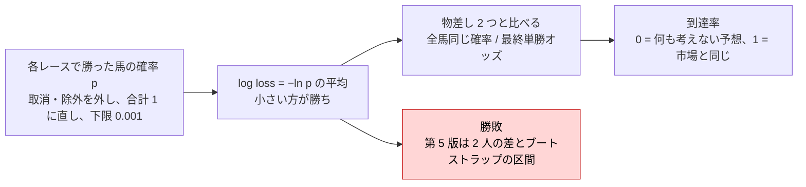

# 今の流れの図(2026-11-03 時点)

> **古い設計です(2026-11-03)。** 採点を儲けに変え、AI競馬予想マスターズの形を土台にすることになりました。今の案は `記録/20261103_ルール案_マスターズ型.md`。

ルールを話し合うための図。元は `ルール.md`(第 5 版、決定)と `記録/20261102_ルール第6版案.md`(案、未採用)。

色の見方:
- 白: 第 5 版で決まっていること。
- 黄・点線: 第 6 版案(未採用)。番号は C-xx・Q-xx。
- 赤: 第 5 版で決まっていない所(話し合いが要る)。

## 1. 大会全体の日程

## 2. 1 開催日の流れ(例: 11/14 土 の分)

## 3. 提出の判定(どの確率で採点するか)

## 4. 採点

## 5. 5 人になって見直しが要る所(事実だけ)

第 5 版と第 6 版案は 2 人の前提で書いてある。

- 勝敗: 5 節は「2 人の差」の区間と、平均の大小で決める。5 人の順位の決め方は無い。
- 作り直しの確認: 主催エージェントが全員分を作り直す。人数が 2.5 倍になる。
- 提出の push: 公開リポジトリでも、push できるのは共同編集者だけ。今は主催だけ。
- 相手のファイルを変えない(案 C-20)、`記録/参加者.md`: 2 人で書く前提。
- おまけ: 「3 者」(モデル 2 つと人間代表)。馬券は「本人と友人がまとめて買う」。
- `趣旨.md`: 「友人と 2 人の個人ハッカソン」「大会後も非公開」。
