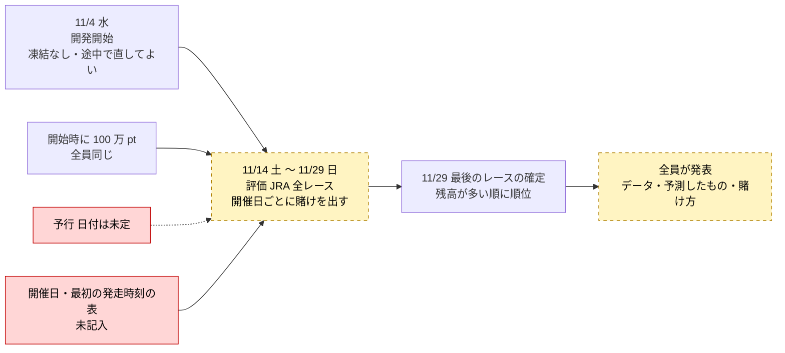
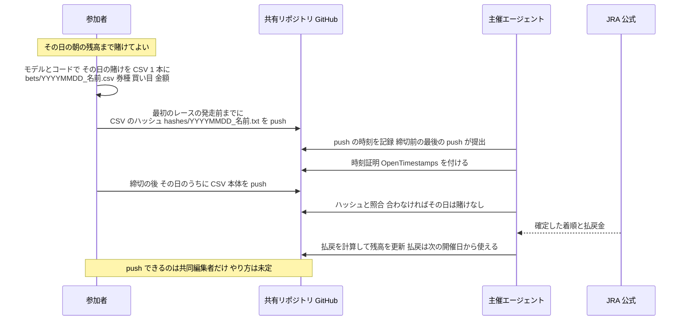
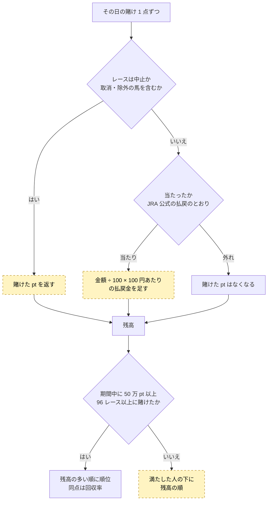

# 流れの図(マスターズ型のルール案、2026-11-03)

ルール案 `記録/20261103_ルール案_マスターズ型.md` を図にしたもの。**どれもまだ案です。**

色の見方:
- 紫: AI競馬予想マスターズ 2025 学生大会と同じ所。
- 黄・点線: 私たちに合わせて足した・変えた所(案)。図 2 は全体が私たちの案(マスターズは API で登録)。
- 赤: まだ決まっていない所。

## 1. 大会全体の日程

## 2. 1 開催日の流れ

## 3. 採点

